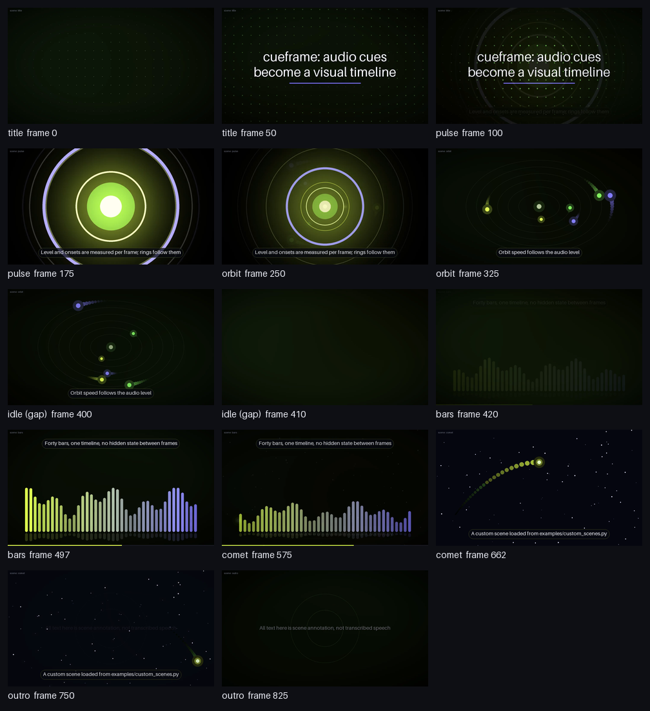
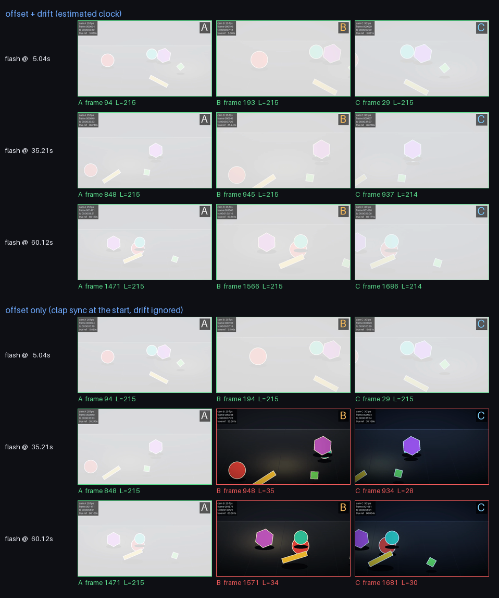
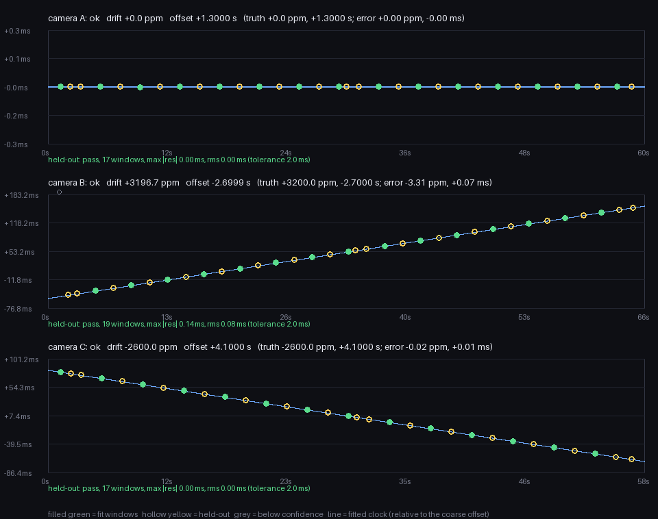

# Cueframe

**One frame-exact timeline, two ways to make a video.** Turn local audio and hand-authored
cues into custom animation, or estimate camera clocks from audio and assemble a multicamera
edit. Python library and CLI; local processing; no model downloads or service accounts.

| Audio → animation | Multicamera → verified edit |
| --- | --- |
| PCM WAV + cue JSON + Pillow scene functions | Reference audio + constant-frame-rate camera media |
| Per-frame level/onset drives your own artwork | Windowed GCC-PHAT estimates offset and affine clock drift |
| Explicit cue boundaries, gaps and crossfades | Held-out residual checks, source bounds and contiguous shots |
| No camera inputs or sync stage | Reference audio is trimmed and muxed into the final edit |



[Watch the synthetic animation (36 s)](docs/animation_preview.mp4) ·
[Watch the multicamera edit excerpt (12 s)](docs/multicam_preview.mp4)

## Install from this checkout

Python 3.11+ and `ffmpeg` / `ffprobe` on `PATH` are required. Use an FFmpeg build with
`libx264` and AAC support. For example, install FFmpeg through your operating system's package
manager, then:

```sh
python3 -m venv .venv
. .venv/bin/activate
python -m pip install '.[dev]'
python -m cueframe --help
```

The examples below assume your working directory is this checkout. The demo command uses
`examples/custom_scenes.py`, which is included here; it is not included in the library wheel.
Generated outputs go under `out/` and are excluded from version control.

For source development, `python -m pip install -e '.[dev]'` is optional. If an environment
hides or ignores editable-install `.pth` files, use the regular install above and reinstall
after edits. The standard installed CLI and library do not require `PYTHONPATH`.

## Quick start 1: audio and your own animation

Generate non-speech music, invented cues, six scenes (including a custom comet), and an MP4:

```sh
python -m cueframe demo animation --out out/animation --quick
```

The quick version is 9 seconds at 320×180. Omit `--quick` for 36 seconds at 960×540. The
output includes `piece.wav`, editable `cues.json`, `animation.mp4`, and a contact sheet.
Render again after changing the cues or the scene functions:

```sh
python -m cueframe animate out/animation/piece.wav out/animation/cues.json out/remix.mp4 \
  --scenes examples/custom_scenes.py --sheet out/remix.png
python -m cueframe scenes --scenes examples/custom_scenes.py
```

Use your own uncompressed PCM WAV in place of `piece.wav`. Cue end times must fit its duration.
For other audio formats, convert locally first, for example:

```sh
ffmpeg -i input.m4a -ac 1 -ar 48000 audio.wav
```

A minimal cue file:

```json
{
  "fps": 25,
  "size": [960, 540],
  "crossfade": 0.0,
  "note": "Hand-authored scene annotations",
  "cues": [
    {"start": 0.0, "end": 3.0, "scene": "title", "text": "A quiet opening"},
    {"start": 3.0, "end": 6.0, "scene": "comet", "text": "Make the scene your own"}
  ]
}
```

Cues are sorted and non-overlapping. Boundaries select the nearest frame, with half frames
rounded up; each cue must occupy at least one frame. Gaps use `idle`. The total frame count
is the ceiling of audio duration × frame rate (with a tiny numerical tolerance), so a final
partial frame is retained. Optional crossfades blend the outgoing scene into each new
segment, including gaps. They do not move cue boundaries. Output dimensions must be even.

Custom scenes are ordinary Pillow drawing functions:

```python
# my_scenes.py — trusted, locally authored Python
from PIL import ImageDraw

def glow(ctx, canvas):
    draw = ImageDraw.Draw(canvas)
    x, y = ctx.width / 2, ctx.height / 2
    r = ctx.height * (0.12 + 0.2 * ctx.level)
    draw.ellipse((x-r, y-r, x+r, y+r), fill=(100, 190, 240))

SCENES = {"glow": glow}
```

Load with `--scenes my_scenes.py` and name `glow` in the cue file. The module is executed with
your normal Python privileges; only load code you trust. Cue JSON chooses dictionary names
and cannot import modules. Custom names can override built-ins.

`FrameContext` supplies `frame`, `t`, exact `fps`, output dimensions, `n_frames`, the active
`cue` (or `None`), `text`, `cue_index`, `cue_frame`, bounded `cue_progress`, smoothed `level`,
positive `onset`, and `seed`. Draw into the supplied RGB canvas. Derive motion from these
values rather than mutable global state. See [the complete example](examples/custom_scenes.py).
The same API works directly from Python:

```python
from cueframe.animate import animate, build_scene_set
from cueframe.cues import load_cues

animate("audio.wav", load_cues("cues.json"), "animation.mp4",
        scene_set=build_scene_set("my_scenes.py"))
```

## Quick start 2: estimate, verify, plan, cut

```sh
python -m cueframe demo multicam --out out/multicam --quick
```

This creates three virtual cameras, a separate reference WAV, estimated clocks, held-out
verification, a shot plan, the edit, a flash-oracle report, and visual proof. The quick
fixture has a 30-second reference at 320×180; the default has a 64-second reference at
854×480. The edit uses the cameras' common coverage with safety margins. Drift is deliberately
exaggerated (thousands of ppm) to become visible during a short take.

The individual commands make the evidence boundary explicit:

```sh
python -m cueframe stage --out out/stage --quick
python -m cueframe sync out/stage/inputs.json --out out/sync.json
python -m cueframe verify out/sync.json --out out/verify.json
python -m cueframe plan out/sync.json --out out/plan.json --size 320x180
python -m cueframe cut out/plan.json --audio out/stage/reference.wav --out out/edit.mp4
python -m cueframe oracle out/stage/manifest.json out/plan.json out/edit.mp4
```

For your own local media, write an `inputs.json` with paths relative to that file:

```json
{"reference": "reference.wav", "cameras": [
  {"name": "wide", "path": "wide.mov"},
  {"name": "detail", "path": "detail.mov"}
]}
```

Run `sync` onward, inspect both reports, and proceed only when verification passes. The
standalone `plan` command accepts successful clock estimates; it does not automatically run
`verify`. The synthetic-only `oracle` requires generator truth and does not apply to real
recordings. CLI exit codes are 0 for success, 1 for failed checks and 2 for invalid input.



The upper group uses estimated offset **and** rate; the lower group holds the early clap
alignment fixed and ignores drift. White frames show the planted flash. The chart plots fit
measurements (green) and held-out measurements (yellow) against the fitted clock:



The included seed-1 full demo produced a 1,405-frame edit (56.2 s at 25 fps), with all
12 flash events passing the pixel oracle. These are synthetic measurements:

| Camera | Planted drift (ppm) | Estimated drift (ppm) | Held-out max residual (ms) |
| --- | ---: | ---: | ---: |
| A | 0 | 0.00 | <0.001 |
| B | +3200 | +3196.69 | 0.139 |
| C | −2600 | −2600.02 | 0.002 |

The animation output has 900 frames (36 s), including the custom comet and an explicit idle
gap. All preview media is generated from code. Seeded audio and scene logic are deterministic;
encoded bytes can vary with FFmpeg, Pillow, NumPy and platform versions.

## Timing and checks

The shared core is `Timeline[Payload]`, built from half-open frame segments `[f0, f1)`.
Adjacent boundaries are identical; the first frame is 0 and the last is `n_frames`. Animation
uses `Cue` payloads; multicamera planning uses `Shot` payloads. Frame rates use exact fractions,
including `30000/1001`.

Camera clocks use `t_reference = offset + rate × t_camera`. Positive drift means one camera
second spans more than one reference second. Coarse audio matching finds an offset, fine
windows refine an affine fit with Theil–Sen and outlier rejection, and verification measures
residuals at different centers. A pass requires at least three confident measurements spanning
at least half the predicted overlapping recording and maximum residual within 2 ms by default.
Held-out windows have different centers but can overlap fitting windows in their audio samples;
this is a temporal consistency check, not statistically independent data collection.

Each shot starts on its camera's frame grid, records the rounding error, and applies the
estimated clock rate throughout playback. The cutter validates source ranges, renders a fixed
number of frames per shot and checks the output. Different source rates are supported by
frame duplication/drop, without optical flow. Inputs use argv-based FFmpeg calls; plan fields
are validated before becoming filter parameters. Scene modules remain explicitly trusted code.

Tests include hand-computed cue boundaries and a custom scene's color signature, untouched
input fingerprints, silence/short/periodic/unrelated-audio controls, late matches in a longer
reference, sparse verification coverage, clock-rate rendering against a pixel time ruler,
plan tampering, source bounds, unequal frame rates, and positive/negative flash-oracle controls.
A 600-second synthetic audio fixture also tests +62 and −38 ppm drift. Estimation and planning
never read the planted clocks or flash manifest; only proof/report code does.

```sh
python -m pytest -q
python -m ruff check .
python scripts/check.py --fast
python scripts/demo.py --out out/showcase --docs docs
python scripts/check_publish.py
```

`check.py` runs lint, tests, quick demos and the payload check (`--fast` skips slow tests and
demos). CI is configured for Python 3.11–3.13 on Linux; hosted CI execution is separate from
local validation. `check_publish.py` excludes development caches from its inventory, rejects
unexpected public files and sensitive text patterns, inspects PNG/MP4 metadata and limits
showcase asset size. Use `--strict-clean` on an exported folder and `--manifest ../manifest.json`
to hash every public file. This is a release hygiene check, not a guarantee that arbitrary
input media is safe to publish.

## Scope and provenance

This is a fresh generic implementation of timing, audio-analysis and rendering techniques
used in private media workflows. Original project code, recordings, transcripts, identities,
editorial parameters and history are not included. Both demos are generated from code: abstract
geometry, virtual cameras, synthesized non-speech audio and invented scene annotations. No
claim about the original production system's measured accuracy is made here.

This compact project has no GUI, transcription, speaker detection, face tracking or automatic
editorial judgment. Animation reads integer PCM WAV and analyzes a mono downmix. The video
keeps the source audio channel layout through AAC encoding; it is not a bit-exact audio copy.
The multicamera path assumes constant frame rate, a single affine clock relationship and
sufficient shared distinctive audio. Confidence/ambiguity gates are heuristics. Synthetic
success does not establish reliability on arbitrary cameras, noisy rooms, nonlinear drift,
variable-frame-rate files or long production sessions. Frame selection and short flash tests
have frame-grid tolerance; they are not a subframe visual alignment proof.

MIT licensed. Dependency and external executable terms are described in
[THIRD_PARTY.md](THIRD_PARTY.md). Measured showcase results are in [docs/results.json](docs/results.json).
