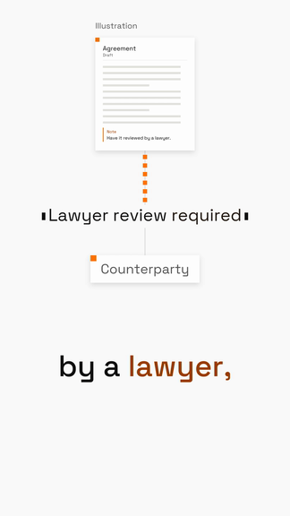

# Hong Kong #2

**Watch Cueframe's first example from a real production.** This 13.5-second excerpt
follows a draft agreement to the point where it needs a lawyer's review.
[Watch or download the MP4](../../docs/hk2_demo.mp4)

[](../../docs/hk2_demo.mp4)

## How it works

The original vAPI Network film used project-specific Python, Pillow and FFmpeg.
This adaptation uses Cueframe's timeline, cue sheet and `animate` renderer to
combine the camera footage, recorded speech, captions and agreement illustration.
Codex prepared the sources and timings. Claude Opus 5.5 adapted the illustration
and captions as Cueframe scene functions.

The excerpt is 405 frames at 30 fps on a 1080 × 1920 canvas. The lobby scene
uses a colour-graded camera shot. At frame 96, the cue sheet cuts to the agreement
illustration. The same draft gains a note, moves toward the counterparty and
pauses at “Lawyer review required.” The caption pages and word timing come from
the original edit. Words with low alignment confidence retain that flag.

- [run.py](run.py) verifies source hashes, selects the exact PCM samples, applies the
  lobby grade and builds the frame timeline, cue sheet and caption plan.
- [motion.py](motion.py) provides the lobby, agreement and caption drawing functions.
- [review.py](review.py) calls Cueframe's renderer, verifies the export and builds a
  side-by-side review with the original.
- [input-manifest.json](input-manifest.json) records the required inputs and their hashes.

## Run from a clean checkout

The finished MP4 and preview still are included. To try the same Cueframe renderer
with self-contained inputs, run the synthetic animation quick start from the
repository root. Python 3.11+ and FFmpeg/ffprobe must be on `PATH`. Use an FFmpeg
build with `libx264`, AAC and the `h264_metadata` bitstream filter.

```sh
python3 -m venv --copies .venv
.venv/bin/python -m pip install -e .
.venv/bin/python -m cueframe demo animation --out out/animation --quick
```

The quick start generates `out/animation/animation.mp4`, a WAV file, an editable cue
sheet and a contact sheet. [Customize the synthetic example](../../README.md#quick-start-1-audio-and-your-own-animation)

## Rebuild this excerpt with private inputs

An exact reconstruction requires the matching private camera footage, processed
voice WAV, full reference film, fonts, LUT and source edit records. The public
checkout includes the scene code, the source manifest and the finished example.
The private inputs are kept outside version control and are not distributed.
[Input manifest](input-manifest.json) · [Media rights](../../THIRD_PARTY.md#hong-kong-2)

If you already have authorized copies of those files, place them under
`work/hk2/inputs/` and `work/hk2/reference/` as listed in the manifest. In addition
to the requirements above, FFmpeg needs the FFV1 encoder and `lut3d` filter.

```sh
.venv/bin/python examples/hk2/run.py prepare --inputs work/hk2/inputs --out work/hk2/prepared
.venv/bin/python examples/hk2/run.py verify-prepared --inputs work/hk2/inputs --out work/hk2/prepared
.venv/bin/python examples/hk2/run.py render --inputs work/hk2/prepared --out work/hk2/review
.venv/bin/python examples/hk2/run.py verify --inputs work/hk2/prepared --out work/hk2/review
```

For a different folder layout, use `--reference` with `prepare` and
`verify-prepared`, and `--sources` with `render` and `verify`. The prepared folder
contains the selected voice, clean lobby clip, cue sheet and timing plan. Open
`work/hk2/review/index.html` after verification to compare the rendered excerpt
with the original. The automated checks cover decoding, frame count, colour,
audio alignment, caption state and matched frames. Full-speed playback is how
you assess the speech and motion together.
